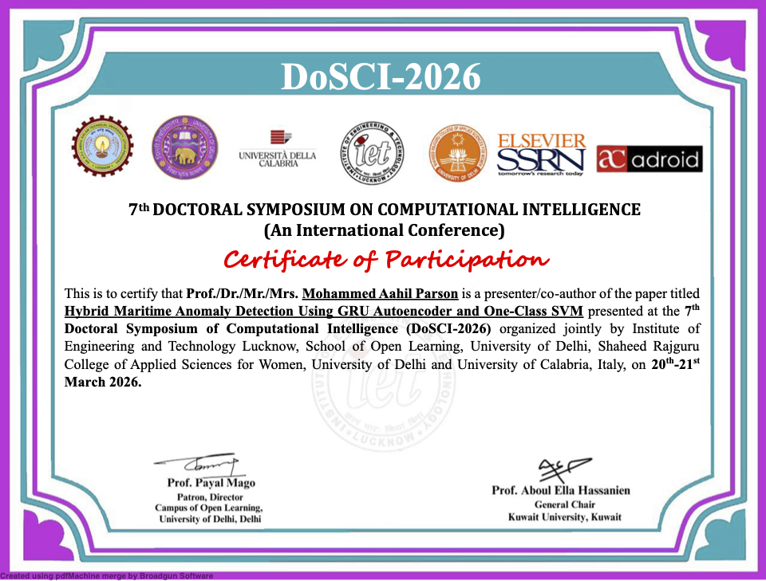

# 🚢 Hybrid Maritime Anomaly Detection Using GRU Autoencoder and One-Class SVM

> Detecting unusual vessel movement patterns from AIS trajectory data using a lightweight hybrid deep learning pipeline.

---

## 📄 Paper

**Title:** [Hybrid Maritime Anomaly Detection Using GRU Autoencoder and One-Class SVM](https://papers.ssrn.com/sol3/papers.cfm?abstract_id=6347558)  
**Authors:** Mohammed Aahil Parson, Divyaprabha K N  
**Affiliation:** PES University, Bangalore, India  
📖 [Read the paper on SSRN](https://papers.ssrn.com/sol3/papers.cfm?abstract_id=6347558)

---

## 📦 Dataset

This project uses **Baltic Sea AIS trajectory data (2017–2019)** sourced from [GitHub – Marine Traffic Modelling](https://github.com/hakola/marine-traffic-modelling?tab=readme-ov-file).

---

## 🔍 Project Overview

Detecting anomalous vessel behavior is challenging — real-world anomaly labels are scarce and AIS data is often noisy or incomplete.

This project tackles the problem with a simple hybrid pipeline:

- 🧠 **GRU Autoencoder** — learns compact representations of normal vessel trajectories
- 🎯 **One-Class SVM** — detects abnormal patterns in the learned latent space

This makes the approach practical for anomaly detection in **low-label environments**.

---

## ✨ Key Highlights

- 📡 Uses **AIS trajectory data** from the Baltic Sea
- 🪟 Works on **fixed 10-step trajectory windows**
- 📐 Learns **normal vessel movement patterns**
- 🚨 Detects anomalies **without relying on labeled abnormal data**
- 🧪 Evaluated using realistic synthetic anomaly scenarios
- ⚡ Achieves strong results with a **lightweight pipeline**

---

## ⚙️ Environment Setup

Requires Python 3.10+ (tested on Python 3.13 with TensorFlow 2.21).

```bash
python3 -m venv .venv
source .venv/bin/activate        # Windows: .venv\Scripts\activate
pip install --upgrade pip
pip install -r requirements.txt
```

---

## 🗂️ Repository Layout

```
scripts/
  train_autoencoder.py         # trains the Bidirectional GRU autoencoder and the scaler
  train_detector.py            # trains the One-Class SVM on latent vectors and evaluates it
maritime_ad/                   # shared code: paths, data loading, windowing, anomaly injection
app/
  api.py                       # Flask API: hybrid ML + rule scoring (port 5002)
  live_client.py               # streams live AIS from aisstream.io to the API and the map (port 5003)
  demo.html                    # live map; open it in a browser
tests/                         # unit tests, plus an end-to-end run of both scripts
data/  models/  results/       # created locally, not committed
```

---

## 🔁 Reproducing the Model

1. Download `data/datasets.zip` from the dataset repository above (about 290 MB) and extract `datasets/training_set.csv` to `data/training_set.csv`.
2. Train the autoencoder, then the detector:

```bash
python scripts/train_autoencoder.py      # add --sample-vessels 0.2 --epochs 5 for a quick trial run
python scripts/train_detector.py
```

The scripts write the trained files to `models/latest-model/`, which is where `app/api.py` reads them:

| File | Written by | Contents |
|---|---|---|
| `final_data_scaler.pkl` | `train_autoencoder.py` | StandardScaler for the 5 input features |
| `final_autoencoder_model.keras` | `train_autoencoder.py` | Full autoencoder |
| `gru_encoder.keras` | `train_autoencoder.py` | Encoder half: 10 × 5 window → 128-d latent vector |
| `final_anomaly_detector.pkl` | `train_detector.py` | One-Class SVM, `nu` chosen on the validation vessels |

`train_detector.py` also writes `results/detector_metrics.json` and its plots. Run either script with `--help` to see its options. Other hyperparameters are set near the top of each script, and window length, features and paths live in `maritime_ad/config.py`. To use other locations, set `MARITIME_DATA_CSV`, `MARITIME_MODEL_DIR` or `MARITIME_RESULTS_DIR`.

The scripts are split into sections with `# %%` markers, so editors such as VS Code can also run them section by section with plots shown inline.

Run the tests with `pytest`.

---

## 🛰️ Running the Live Demo

Requires a trained model in `models/latest-model/` and an [aisstream.io](https://aisstream.io) API key.

```bash
python app/api.py                                   # terminal 1: API on port 5002
export AISSTREAM_API_KEY="your-key-here"
python app/live_client.py                           # terminal 2: live stream on port 5003
```

Then open `app/demo.html` in a browser.

---

## 🛠️ Method

### 1. Data Preparation
Each vessel's AIS track is sorted by time and cut into overlapping 10-step windows of latitude, longitude, speed, course and heading, which are standardized before training. Rows with missing values are dropped, and a missing heading falls back to the course. Vessels are split into train, validation and test sets, so no vessel appears in more than one set.

### 2. Feature Learning
A **Bidirectional GRU Autoencoder** learns a compact latent representation of normal ship movement.

### 3. Anomaly Detection
The latent vectors are passed to a **One-Class SVM**, which flags patterns that fall outside the learned boundary of normal behavior.

---

## 🧪 Evaluation

The model was tested against the following synthetic anomaly patterns:

| Anomaly Type | Description |
|---|---|
| Speed Spike | Sudden, unrealistic acceleration |
| Direction Change | Abrupt heading shifts |
| Location Jump | Teleportation-like positional gaps |
| Slow Movement | Irregular, unusually slow traversal |

---

## 📊 Results

| Metric | Score |
|---|---|
| **Precision** | 99.20% |
| **Recall** | 74.04% |
| **F1-Score** | 84.79% |

The hybrid GRU-AE + One-Class SVM model effectively detects anomalous trajectories while remaining computationally efficient.

> **Note:** these figures come from the original version of the detector training code. The pipeline has since been corrected: windows now follow each vessel's time-ordered track, anomalies are injected per vessel, and `nu` is chosen on validation data rather than the test set. Re-running the training scripts produces updated figures in `results/detector_metrics.json`.

---

## 🌍 Why This Matters

This work is designed for real-world maritime monitoring systems where anomaly labels are scarce and fast, lightweight detection is critical.

**Potential applications include:**
- 🛳️ Maritime surveillance
- 🏗️ Port and coastal security
- 🔎 Suspicious trajectory detection
- 📡 AIS-based vessel behavior monitoring

---

## 📝 Citation

If you use this repository or build upon this work, please cite:

**Mohammed Aahil Parson, Divyaprabha K N**  
[*Hybrid Maritime Anomaly Detection Using GRU Autoencoder and One-Class SVM*](https://papers.ssrn.com/sol3/papers.cfm?abstract_id=6347558)  
SSRN

---

## 🏆 Conference Certificate

This paper was presented at the **7th Doctoral Symposium on Computational Intelligence (DoSCI-2026)**.



---


## 🙏 Acknowledgment

This repository is based on published research on maritime anomaly detection using AIS trajectory data, with a focus on building a practical and efficient anomaly detection pipeline.
